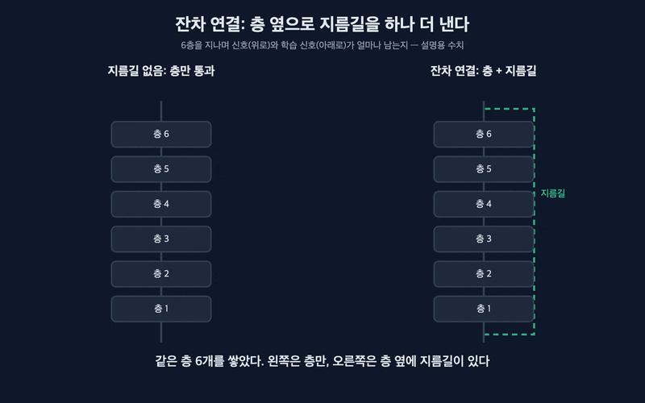
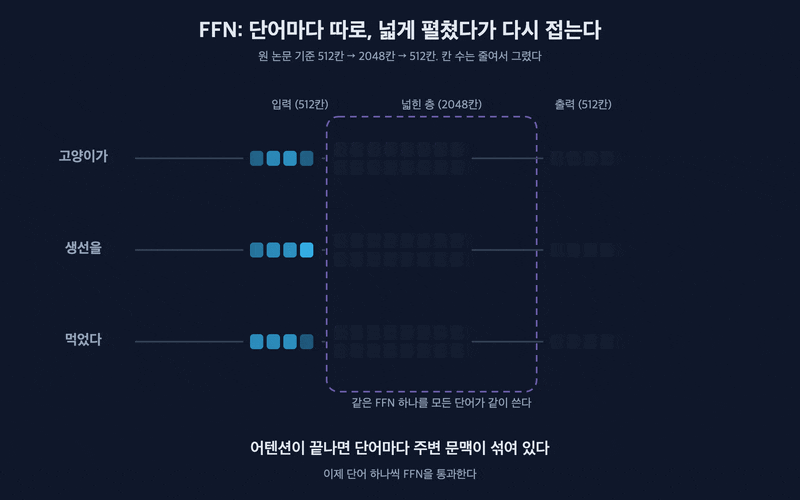
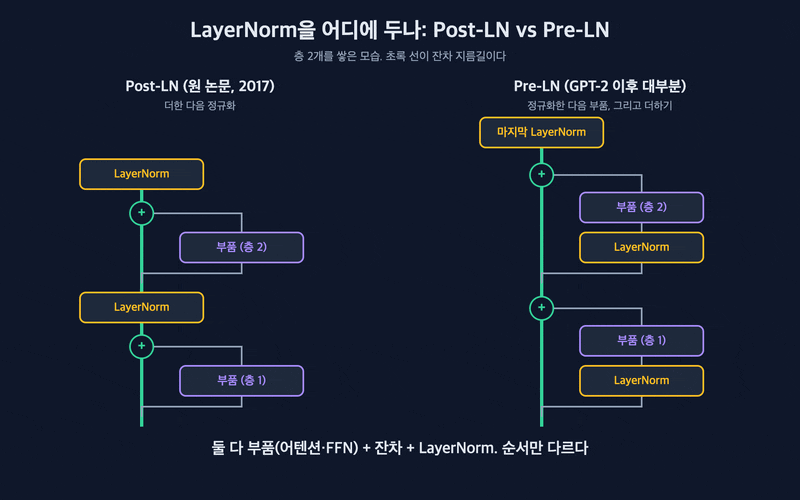

트랜스포머 깊게 보기 시리즈 2부의 네 번째 편이다. #4부터 #6까지는 어텐션과 위치 인코딩을 봤다. 그런데 트랜스포머 구조 그림을 다시 보면 어텐션 상자 위아래로 `Add & Norm`과 `Feed Forward`라는 상자가 계속 붙어 있다. 처음 그림을 봤을 때 나는 이게 부록 같은 건 줄 알았다. 알고 보니 이 부품들이 없으면 트랜스포머는 6층도 제대로 못 쌓는다. 이번 편은 잔차 연결, LayerNorm, FFN이 각각 무슨 일을 하는지, 그리고 원 논문의 Post-LN이 요즘 Pre-LN으로 바뀐 이유를 다룬다. 전체 지도는 [Attention Is All You Need](/posts/attention-is-all-you-need/) 글에 있다.

## 한눈에 보기

트랜스포머의 층 하나는 "어텐션 + FFN"이고, 각 부품을 잔차 연결과 LayerNorm이 감싼다.

- 잔차 연결은 부품 옆으로 지름길을 내서, 입력을 출력에 그대로 더한다. 층을 깊게 쌓아도 정보와 학습 신호가 사라지지 않는다.
- LayerNorm은 단어마다 숫자들의 크기를 일정한 범위로 맞춘다. 층을 지날 때마다 값이 커지거나 쪼그라드는 걸 막는다.
- FFN은 어텐션으로 주변 문맥을 모은 뒤, 단어마다 따로 "생각을 정리"하는 작은 신경망이다. 층 하나의 매개변수 중 3분의 2가 여기 있다.

## 왜 필요할까: 전화기 게임

여러 사람이 한 줄로 서서 귓속말로 문장을 전달하는 게임을 생각해보자. 사람이 3명이면 그럭저럭 맞는다. 20명이면 끝에 도착한 문장은 처음과 전혀 다르다. 한 사람이 조금씩만 틀려도, 그 오차가 사람 수만큼 쌓인다.

신경망 층도 똑같다. 층 하나가 입력을 조금씩 바꾸고, 그게 수십 번 반복된다. 위로 올라가는 정보도 흐려지지만 더 큰 문제는 반대 방향이다. 학습할 때는 맨 위에서 "이만큼 틀렸다"는 신호가 아래층으로 거꾸로 내려가야 하는데, 이 신호도 층을 지날 때마다 약해진다. 맨 아래층은 무엇을 고쳐야 하는지 거의 모른 채로 남는다.

해결책은 단순하다. 귓속말과 별도로 원래 문장이 적힌 쪽지를 맨 끝까지 같이 돌리는 것이다. 각 사람은 쪽지 내용에 "내가 덧붙일 말"만 더한다. 이게 잔차 연결이다.

## 어떻게 동작할까

### 잔차 연결: 층은 "고칠 몫"만 배운다

잔차 연결은 부품의 입력을 출력에 그대로 더한다. 어텐션 층이라면 "어텐션 결과 + 원래 입력"이 다음으로 넘어간다.

이렇게 하면 층이 하는 일이 바뀐다. 입력 전체를 새로 만들어내는 대신 "원래 것에서 얼마나 고칠지"만 배우면 된다. 고칠 게 없으면 0을 내면 그만이다. 그래서 층을 많이 쌓아도 최소한 원래 정보는 지름길로 그대로 올라온다. 학습 신호도 같은 지름길을 타고 맨 아래층까지 줄지 않고 내려간다.

_층만 지나면 갈수록 흐려지고, 지름길이 있으면 그대로 남는다 (설명용 수치)_

이 아이디어는 트랜스포머가 처음 만든 게 아니다. 2015년 이미지 인식 논문[2]이 이 지름길로 152층짜리 신경망을 학습시키면서 널리 퍼졌다. 트랜스포머는 이걸 어텐션과 FFN마다 하나씩 붙였다. 원 논문[1]은 이 덕분에 같은 층을 6번 쌓을 수 있었고, 요즘 대형 모델은 수십에서 100층 가까이 쌓는다.

### LayerNorm: 단어마다 눈금을 맞춘다

지름길로 계속 더하다 보면 다른 문제가 생긴다. 층마다 값이 더해지니 숫자가 점점 커지거나, 어떤 단어는 값이 크고 어떤 단어는 작아서 들쭉날쭉해진다. 다음 층 입장에서는 매번 다른 크기의 숫자가 들어오니 학습이 불안정해진다.

LayerNorm(층 정규화)[3]은 단어 하나가 가진 512개 숫자를 보고, 평균은 0, 퍼진 정도는 1이 되게 맞춘다. 시험 점수를 과목마다 다른 만점 대신 같은 기준으로 환산하는 것과 비슷하다. 맞춘 뒤에는 모델이 학습한 비율로 다시 늘리거나 옮길 수 있어서, 필요한 정보까지 잃지는 않는다.

이미지 쪽에서 많이 쓰던 BatchNorm은 여러 문장(배치)에 걸쳐서 평균을 낸다. 문장마다 길이가 다르고, 생성할 때는 한 문장씩 처리하니 이 방식이 잘 맞지 않는다. LayerNorm은 단어 하나 안에서만 계산하니 배치 크기나 문장 길이와 상관이 없다. 트랜스포머가 LayerNorm을 쓰는 이유다.

### FFN: 회의가 끝나면 각자 생각을 정리한다

어텐션은 단어끼리 정보를 주고받는 회의다. "그것"이 "고양이"를 가리킨다는 걸 알아내는 일이 여기서 일어난다. 회의가 끝나면 각 단어에는 주변 문맥이 섞여 있다. 이제 그걸 소화할 시간이 필요하다.

FFN(Feed-Forward Network, 피드포워드 신경망)이 그 일을 한다. 단어 하나의 512개 숫자를 4배 넓은 2048개로 펼치고, 쓸모없는 칸은 끄고(ReLU), 다시 512개로 접는다. 넓게 펼친 공간에서 여러 특징을 따로따로 확인한 뒤 결과만 요약해 돌려주는 셈이다.

_같은 FFN을 단어마다 따로 적용한다. 옆 단어는 보지 않는다_

중요한 점은 FFN이 옆 단어를 보지 않는다는 것이다. 문장 안 모든 단어가 같은 FFN을 각자 통과한다. 단어끼리 정보를 섞는 건 어텐션뿐이고, FFN은 단어 하나를 깊게 다듬는다.

작아 보이지만 FFN은 크다. 원 논문 크기로 세어보면 층 하나에서 어텐션의 가중치는 약 100만 개, FFN은 약 200만 개다. 층 하나의 매개변수 3분의 2가 FFN에 있다. 후속 연구[6]는 FFN이 "이런 패턴이 보이면 이런 단어를 떠올려라" 같은 지식을 저장하는 기억 장치처럼 동작한다고 분석했다. 모델이 배운 사실 지식의 상당 부분이 여기 들어 있다고 보는 시각이 많다.

### Post-LN에서 Pre-LN으로

이제 부품 셋을 어떻게 이어 붙일지가 남았다. 원 논문은 "부품 → 지름길 더하기 → LayerNorm" 순서를 썼다. 정규화가 더하기 뒤에 오니 Post-LN이라고 부른다.

문제는 지름길이 층마다 LayerNorm을 통과한다는 것이다. 원래 입력이 그대로 올라와야 하는 길인데, 층마다 한 번씩 눈금이 다시 맞춰진다. 층이 깊어지면 학습 초반에 출력 쪽 층들의 기울기가 지나치게 커지고, 학습률을 처음부터 크게 주면 학습이 깨진다. 그래서 원 논문은 학습률을 아주 작게 시작해서 서서히 올리는 warmup을 반드시 해야 했다(다음 편에서 다룬다).

2019년 GPT-2[5]는 순서를 바꿨다. "LayerNorm → 부품 → 지름길 더하기". 정규화가 앞으로 가서 Pre-LN이라고 부른다. 이러면 지름길은 처음부터 끝까지 아무것도 통과하지 않는다. 대신 맨 마지막에 LayerNorm을 하나 더 붙여서 최종 출력의 크기를 맞춘다.

_순서만 바꿨는데 지름길이 끊기지 않는다_

2020년 Pre-LN 분석 논문[4]은 이 차이를 이론과 실험으로 보였다. Pre-LN은 warmup 없이도 학습이 되고, 더 빨리 수렴했다. 요즘 GPT 계열, LLaMA[8] 같은 대부분의 대형 모델이 Pre-LN을 쓴다.

## 흔한 오해

"잔차 연결은 성능을 올리는 장치"라고 생각하기 쉽다. 정확히는 학습을 가능하게 하는 장치다. 지름길 자체가 새로운 걸 계산하지는 않는다. 깊게 쌓아도 학습 신호가 아래까지 닿게 해서, 깊은 모델을 학습시킬 수 있게 만든다.

"LayerNorm은 문장 전체를 정규화한다"는 것도 틀렸다. 단어 하나의 숫자들 안에서만 평균과 퍼짐을 맞춘다. 단어끼리는 서로 영향을 주지 않는다. 나도 이름에 "Layer"가 들어가서 층 전체 값을 한꺼번에 맞추는 줄 알았는데, 여기서 Layer는 "한 단어가 이 층에서 가진 값 전체"라는 뜻이다.

"FFN은 단어끼리 정보를 섞는다"도 오해다. FFN은 단어마다 따로 동작한다. 같은 가중치를 쓸 뿐, 옆 단어를 보지 않는다. 단어끼리 섞이는 건 어텐션에서만 일어난다. 대신 층마다 FFN은 서로 다른 가중치를 가진다.

"Pre-LN이 모든 면에서 낫다"고 단정하기도 어렵다. Pre-LN은 학습이 안정적이라는 장점이 크지만, 잘 학습된 Post-LN이 최종 성능은 조금 낫다는 보고도 있다. 둘의 장점을 섞으려는 변형도 계속 나오고 있다. 다만 큰 모델을 안정적으로 학습시키는 게 우선인 요즘은 Pre-LN이 기본값이다.

## 쉽게 정리

| 부품 | 비유 | 하는 일 | 없으면 |
|---|---|---|---|
| 잔차 연결 | 원문 쪽지를 같이 돌리기 | 입력을 출력에 그대로 더한다 | 깊게 쌓으면 정보·학습 신호가 사라진다 |
| LayerNorm | 점수를 같은 기준으로 환산 | 단어마다 숫자 크기를 맞춘다 | 층마다 값이 들쭉날쭉해 학습이 불안정 |
| FFN | 회의 뒤 각자 생각 정리 | 단어마다 넓게 펼쳤다가 접는다 | 모은 문맥을 소화하고 지식을 저장할 곳이 없다 |

| | Post-LN (원 논문) | Pre-LN (요즘 대부분) |
|---|---|---|
| 순서 | 부품 → 더하기 → LayerNorm | LayerNorm → 부품 → 더하기 |
| 지름길 | 층마다 LayerNorm에 끊긴다 | 끝까지 아무것도 통과하지 않는다 |
| warmup | 꼭 필요하다 | 없어도 학습된다 |
| 쓰는 모델 | 원 트랜스포머, BERT | GPT-2 이후 GPT 계열, LLaMA 등 |

어텐션이 트랜스포머의 주인공이라면, 이 세 부품은 주인공이 깊게 쌓여도 버티게 해주는 뼈대다. 요즘 모델은 LayerNorm 대신 더 단순한 RMSNorm을, ReLU FFN 대신 SwiGLU[7]라는 변형을 많이 쓰지만, "지름길 + 정규화 + 단어별 신경망"이라는 뼈대는 그대로다.

## 다음 편

다음 편은 [#8 학습 방법: 마스킹, Teacher Forcing, Warmup](/posts/transformer-08-training/)이다. 지금까지 만든 부품들을 실제로 어떻게 학습시키는지, 그리고 이번 편에서 잠깐 나온 warmup이 왜 필요했는지를 다룬다.

## 학습 확인 질문

1. 층을 깊게 쌓을 때 잔차 연결이 없으면 어떤 문제가 생기나?

   답: 층을 지날 때마다 위로 올라가는 정보가 흐려지고, 학습할 때 맨 위에서 내려오는 "얼마나 틀렸나" 신호도 층마다 약해진다. 맨 아래층은 무엇을 고쳐야 할지 거의 모르게 된다. 잔차 연결은 입력을 출력에 그대로 더하는 지름길을 내서, 정보와 학습 신호가 줄지 않고 오가게 한다.

2. FFN과 어텐션은 하는 일이 어떻게 다른가?

   답: 어텐션은 단어끼리 정보를 주고받는다. FFN은 옆 단어를 보지 않고 단어 하나만 받아서, 넓은 공간으로 펼쳤다가 다시 접으며 다듬는다. 어텐션이 회의라면 FFN은 회의 뒤 각자 자리에서 하는 생각 정리다. 층 하나의 매개변수 대부분이 FFN에 있다.

3. Post-LN과 Pre-LN의 차이는 무엇이고, 요즘 모델이 Pre-LN을 쓰는 이유는?

   답: Post-LN은 "부품 → 더하기 → LayerNorm", Pre-LN은 "LayerNorm → 부품 → 더하기" 순서다. Post-LN은 지름길이 층마다 LayerNorm을 통과해서 깊어질수록 학습 초반이 불안정하고 warmup이 꼭 필요하다. Pre-LN은 지름길이 끝까지 아무것도 거치지 않아서 깊게 쌓아도 안정적으로 학습된다.

## 참고 자료

- [1] [Attention Is All You Need (Vaswani et al., 2017, arXiv)](https://arxiv.org/abs/1706.03762)
- [2] [Deep Residual Learning for Image Recognition (He et al., 2015, arXiv)](https://arxiv.org/abs/1512.03385)
- [3] [Layer Normalization (Ba et al., 2016, arXiv)](https://arxiv.org/abs/1607.06450)
- [4] [On Layer Normalization in the Transformer Architecture (Xiong et al., 2020, arXiv)](https://arxiv.org/abs/2002.04745)
- [5] [Language Models are Unsupervised Multitask Learners (Radford et al., 2019, OpenAI)](https://cdn.openai.com/better-language-models/language_models_are_unsupervised_multitask_learners.pdf)
- [6] [Transformer Feed-Forward Layers Are Key-Value Memories (Geva et al., 2020, arXiv)](https://arxiv.org/abs/2012.14913)
- [7] [GLU Variants Improve Transformer (Shazeer, 2020, arXiv)](https://arxiv.org/abs/2002.05202)
- [8] [LLaMA: Open and Efficient Foundation Language Models (Touvron et al., 2023, arXiv)](https://arxiv.org/abs/2302.13971)
