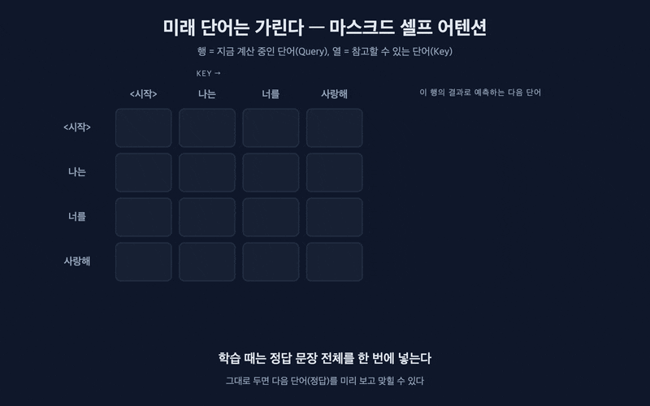
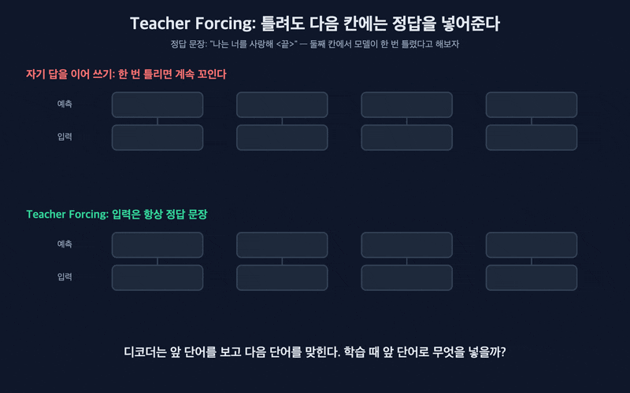
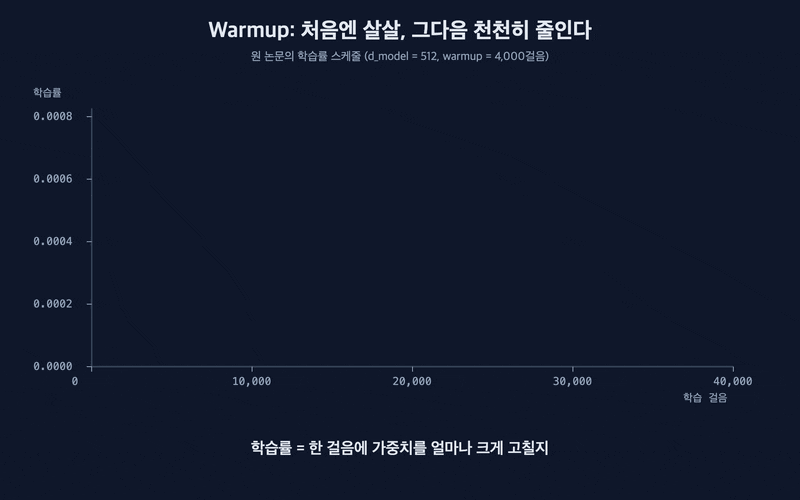

트랜스포머 깊게 보기 시리즈 2부의 마지막 편이다. #4부터 [#7 잔차 연결, LayerNorm, FFN](/posts/transformer-07-residual-layernorm-ffn/)까지 트랜스포머의 부품을 하나씩 봤다. 부품이 다 모였으니 이제 학습을 시켜야 한다. 그런데 막상 원 논문의 학습 부분을 읽어보면 "왜 이렇게 하지?" 싶은 장치가 몇 개 있다. 정답을 가리는 마스크, 틀려도 정답을 넣어주는 Teacher Forcing, 학습률을 0에서 시작하는 warmup이다. 이번 편은 이 세 가지가 각각 어떤 문제를 막는지 다룬다. 전체 지도는 [Attention Is All You Need](/posts/attention-is-all-you-need/) 글에 있다.

## 한눈에 보기

트랜스포머 학습은 "앞 단어들을 보고 다음 단어를 맞히는 문제"를 수없이 푸는 것이다.

- 마스킹은 아직 나오지 않은 뒤쪽 단어를 가린다. 정답을 미리 보고 맞히는 커닝을 막는다.
- Teacher Forcing은 모델이 틀려도 다음 칸에는 정답 단어를 넣어준다. 한 번 틀린 게 뒤까지 번지지 않고, 문장 전체를 한꺼번에 학습할 수 있다.
- Warmup은 학습률을 0에서 시작해 천천히 올린다. 아직 엉망인 학습 초반에 크게 고쳤다가 학습이 깨지는 걸 막는다.

## 왜 필요할까: 받아쓰기 연습

아이에게 받아쓰기를 가르친다고 해보자. 문장을 한 단어씩 불러주고, 아이는 다음 단어를 예상해서 적는다.

정답지를 옆에 펴놓으면 아이는 보고 베낀다. 시험지에서는 다 맞히지만 실제로는 아무것도 못 배운다. 그래서 아직 안 부른 단어는 가려야 한다. 이게 마스킹이다.

아이가 둘째 단어를 틀렸다고 해보자. 선생님이 "그 틀린 단어에 이어서 다음 단어를 맞혀봐"라고 하면, 아이는 이상한 문장 위에서 연습하게 된다. 대신 "정답은 이거였어. 이걸 보고 다음 단어를 맞혀봐"라고 하면 다음 연습은 제대로 된다. 이게 Teacher Forcing이다.

그리고 첫날부터 아이를 다그치면 겁을 먹고 엉뚱한 쪽으로 배운다. 처음엔 살살 고쳐주다가 감이 잡히면 제대로 고쳐준다. 이게 warmup이다.

## 어떻게 동작할까

### 모델이 실제로 푸는 문제

번역 모델이라면 "I love you"를 받고 "나는 너를 사랑해"를 만들어야 한다. 디코더는 한 번에 단어 하나씩 내놓는다. "<시작>"을 보고 "나는", "<시작> 나는"을 보고 "너를", 이런 식이다. 맞힐 때마다 정답 단어에 확률을 얼마나 줬는지로 채점하고, 정답 확률이 높아지는 방향으로 가중치를 고친다.

### 마스킹: 아직 안 나온 단어는 가린다

학습할 때는 정답 문장 "나는 너를 사랑해"를 이미 알고 있다. 디코더에 이 문장을 통째로 넣으면, "나는" 다음 단어를 맞혀야 하는 자리에서 셀프 어텐션으로 "너를"을 그냥 보고 베낄 수 있다.

그래서 어텐션 점수표에서 자기보다 뒤쪽 칸을 전부 가린다. 가려진 칸은 어텐션이 0이 돼서 아예 참고할 수 없다. 표로 그리면 대각선 아래 삼각형만 남는다. 각 단어는 자기 자신과 앞 단어만 볼 수 있다.

_각 행은 자기와 앞 단어만 본다. 실제로 문장을 만들 때와 같은 조건이다_

마스크는 하나가 더 있다. 문장마다 길이가 달라서, 짧은 문장은 빈칸(패딩)을 채워 길이를 맞춘다. 이 빈칸은 의미가 없으니 어텐션이 보지 않도록 역시 가린다. 이건 인코더와 디코더 모두에 쓴다.

### Teacher Forcing: 틀려도 다음 칸에는 정답을

디코더가 다음 단어를 맞히려면 앞 단어들이 필요하다. 그 앞 단어로 무엇을 넣을지가 문제다.

자연스러운 방법은 모델이 방금 낸 답을 넣는 것이다. 실제로 문장을 만들 때는 이렇게 한다. 그런데 학습 초반의 모델은 거의 다 틀린다. 둘째 단어에서 "너를" 대신 "밥을"이라고 하면, 셋째 칸은 "나는 밥을" 다음 단어를 맞히는 문제가 된다. 정답 문장과 상관없는 엉뚱한 문제다. 한 번 틀리면 뒤가 줄줄이 꼬인다.

Teacher Forcing은 모델이 뭐라고 답했든 다음 칸 입력에는 정답 단어를 넣는다. 둘째 칸에서 틀린 건 틀린 대로 채점하고, 셋째 칸은 정답 "나는 너를"을 보고 다시 맞힌다. 모든 칸이 올바른 문제를 푼다.

_위: 자기 답을 이어 쓰기. 아래: Teacher Forcing_

덤으로 엄청난 속도 이득이 생긴다. 입력이 정답 문장으로 이미 정해져 있으니, 앞 칸의 답을 기다릴 필요가 없다. 위의 마스크와 함께 쓰면 문장의 모든 칸을 한 번에 계산할 수 있다. RNN은 학습할 때도 한 칸씩 기다려야 했는데, 트랜스포머는 학습만큼은 문장 전체를 동시에 돌린다. 원 논문이 8장의 GPU로 기본 모델을 12시간 만에 학습시킬 수 있었던 이유 중 하나다.

### Warmup: 처음엔 살살, 그다음 천천히 줄인다

학습률은 한 번 고칠 때 가중치를 얼마나 크게 바꿀지 정하는 값이다. 크면 빨리 배우지만 엉뚱한 쪽으로 튀기 쉽고, 작으면 안정적이지만 느리다.

원 논문[1]은 학습률을 0에서 시작해서 처음 4,000걸음 동안 일정하게 올렸다. 최고점(약 0.0007)을 찍은 뒤에는 걸음 수의 제곱근에 반비례해서 천천히 줄였다. 이 "처음에 올리는 구간"이 warmup이다.

_처음 4,000걸음은 warmup, 이후에는 천천히 감소_

처음부터 최고 학습률로 가면 왜 안 될까. 이유가 두 가지 있다. 하나는 #7에서 본 Post-LN 구조다. 학습 초반에 출력 쪽 층들의 기울기가 크게 튀어서, 큰 학습률과 만나면 학습이 깨진다[4]. 다른 하나는 원 논문이 쓴 Adam이라는 최적화 방법의 성질이다. Adam은 지금까지 기울기의 평균과 퍼짐을 보고 걸음 크기를 정하는데, 학습 맨 처음엔 본 기울기가 몇 개 없어서 이 통계가 믿을 만하지 않다[5]. 믿을 수 없는 통계로 큰 걸음을 걸으면 위험하니, 통계가 쌓일 때까지 살살 간다.

요즘 모델도 warmup은 거의 다 쓴다. 다만 그 뒤에 줄이는 모양은 코사인 곡선이 더 흔하다. LLaMA[6]는 2,000걸음 warmup 뒤에 코사인 모양으로 줄였다.

### 그 밖에 원 논문이 쓴 장치 두 가지

드롭아웃은 학습 중에 일부 값을 무작위로 꺼서, 모델이 특정 값에만 기대지 않게 한다. 원 논문은 각 부품의 출력과 임베딩에 10%를 썼다.

라벨 스무딩[3]은 정답에 100% 확신하지 말라고 가르친다. 정답 단어의 목표 확률을 1 대신 0.9로 두고, 나머지 0.1은 다른 단어들에 나눠준다. 원 논문은 이렇게 하면 모델이 덜 확신하게 돼서 혼란도 지표는 나빠지지만, 정확도와 번역 점수(BLEU)는 오른다고 보고했다. 나는 처음에 "정답을 일부러 흐리는 게 왜 좋지?" 싶었는데, 한 문장을 번역하는 방법이 하나뿐이 아니라는 걸 생각하면 납득이 된다.

## 흔한 오해

"마스크가 있으면 학습할 때도 한 단어씩 만든다"는 오해가 있다. 반대다. 마스크 덕분에 한 단어씩 만들 필요가 없다. 정답 문장을 통째로 넣고, 마스크로 각 칸이 앞쪽만 보게 해서 모든 칸을 한 번에 계산한다. 한 단어씩 만드는 건 학습이 끝난 뒤 실제로 문장을 생성할 때다.

"Teacher Forcing은 단점이 없다"도 틀렸다. 학습 때는 항상 정답을 받아먹다가, 실제로 쓸 때는 자기가 만든 답 위에서 다음 단어를 만들어야 한다. 학습 때 한 번도 겪지 못한 상황이라, 한 번 틀리면 회복하는 법을 모른다. 이걸 노출 편향(exposure bias)이라고 부른다. 학습 중간중간 일부러 모델 자신의 답을 섞어 넣는 방법[2] 같은 보완책이 연구됐다.

"Warmup은 학습을 빠르게 하려는 장치"라고 생각하기 쉽다. 오히려 처음 4,000걸음은 일부러 천천히 간다. 목적은 속도가 아니라 안정성이다. 초반에 학습이 깨지지 않아야 나중에 큰 학습률로 빨리 갈 수 있다.

"마스크는 디코더에만 있다"는 것도 반만 맞다. 미래를 가리는 마스크는 디코더의 셀프 어텐션에만 있다. 패딩을 가리는 마스크는 인코더에도 있다.

## 쉽게 정리

| 장치 | 받아쓰기 비유 | 막는 문제 | 덤으로 얻는 것 |
|---|---|---|---|
| 마스킹 | 아직 안 부른 단어는 가린다 | 정답을 보고 베끼는 커닝 | 실제 생성할 때와 같은 조건 |
| Teacher Forcing | 틀려도 정답을 알려주고 다음 단어로 | 한 번 틀린 게 뒤까지 번지는 것 | 문장 전체를 한꺼번에 학습 |
| Warmup | 첫날은 살살 고쳐준다 | 초반에 크게 고쳐서 학습이 깨지는 것 | 이후 큰 학습률을 쓸 수 있다 |
| 라벨 스무딩 | 정답이 하나뿐이라고 못 박지 않는다 | 지나친 확신 | 번역 품질 향상 |

트랜스포머를 학습시키는 핵심은 "정답 문장을 통째로 넣되, 각 칸은 앞쪽만 보게 하고, 처음엔 살살 고친다"로 요약된다. 마스크와 Teacher Forcing이 짝을 이뤄 학습을 병렬로 만들었고, 이게 트랜스포머가 RNN보다 훨씬 큰 데이터로 학습될 수 있었던 이유다.

## 다음 편

2부는 여기까지다. 다음 편부터는 3부, 트랜스포머 이후의 이야기다. #9에서는 같은 트랜스포머에서 갈라져 나온 BERT, GPT, T5가 인코더와 디코더를 각각 어떻게 골라 쓰는지, 그리고 학습 문제를 어떻게 바꿨는지 비교한다.

## 학습 확인 질문

1. 디코더의 셀프 어텐션에 마스크가 없으면 학습에 어떤 문제가 생기나?

   답: 학습 때는 정답 문장을 통째로 넣기 때문에, 마스크가 없으면 각 칸이 뒤쪽 정답 단어를 그냥 보고 베낄 수 있다. 학습 점수는 좋아지지만 실제로 다음 단어를 예측하는 법은 배우지 못한다. 실제로 문장을 만들 때는 뒤 단어가 없으니 모델이 엉망이 된다.

2. Teacher Forcing이 주는 이득 두 가지는?

   답: 첫째, 모델이 한 칸에서 틀려도 다음 칸은 정답 단어를 보고 맞히니, 한 번 틀린 게 뒤까지 번지지 않고 모든 칸이 올바른 문제로 학습된다. 둘째, 입력이 정답 문장으로 미리 정해져 있어서 앞 칸의 답을 기다릴 필요가 없고, 마스크와 함께 문장 전체를 한 번에 계산할 수 있다.

3. 원 논문의 트랜스포머가 warmup을 꼭 써야 했던 이유는?

   답: 학습 초반에는 가중치가 엉망이라, 큰 학습률로 크게 고치면 엉뚱한 쪽으로 튄다. 특히 원 논문의 Post-LN 구조는 초반에 출력 쪽 기울기가 크게 튀고, Adam의 걸음 크기 통계도 아직 믿을 만하지 않다. 그래서 학습률을 0에서 시작해 4,000걸음 동안 천천히 올린 뒤 줄였다.

## 참고 자료

- [1] [Attention Is All You Need (Vaswani et al., 2017, arXiv)](https://arxiv.org/abs/1706.03762)
- [2] [Scheduled Sampling for Sequence Prediction with Recurrent Neural Networks (Bengio et al., 2015, arXiv)](https://arxiv.org/abs/1506.03099)
- [3] [Rethinking the Inception Architecture for Computer Vision (Szegedy et al., 2015, arXiv)](https://arxiv.org/abs/1512.00567)
- [4] [On Layer Normalization in the Transformer Architecture (Xiong et al., 2020, arXiv)](https://arxiv.org/abs/2002.04745)
- [5] [On the Variance of the Adaptive Learning Rate and Beyond (Liu et al., 2019, arXiv)](https://arxiv.org/abs/1908.03265)
- [6] [LLaMA: Open and Efficient Foundation Language Models (Touvron et al., 2023, arXiv)](https://arxiv.org/abs/2302.13971)
