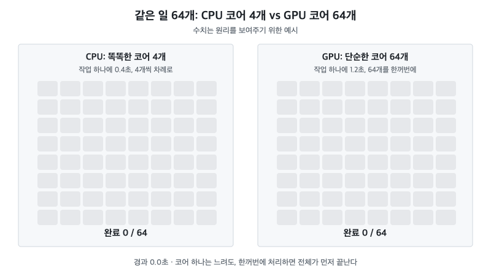
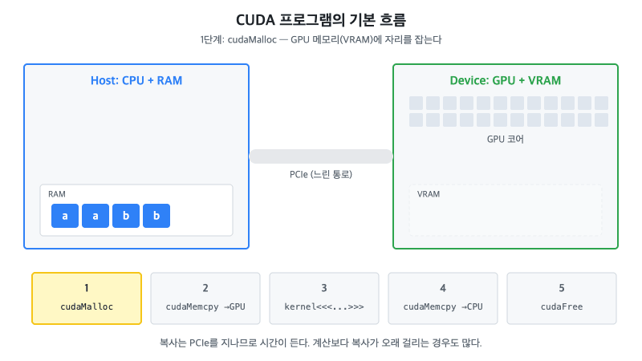
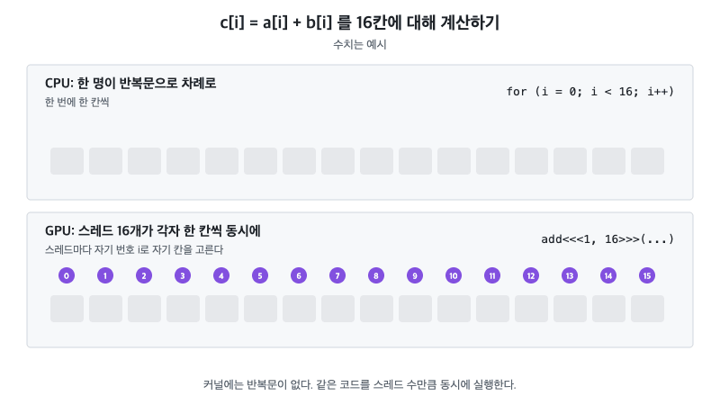
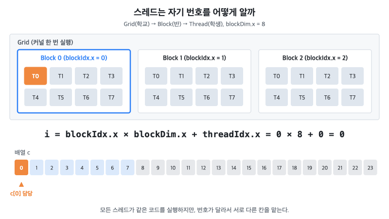
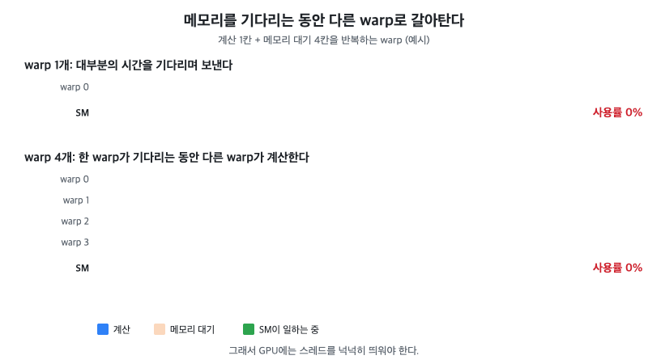
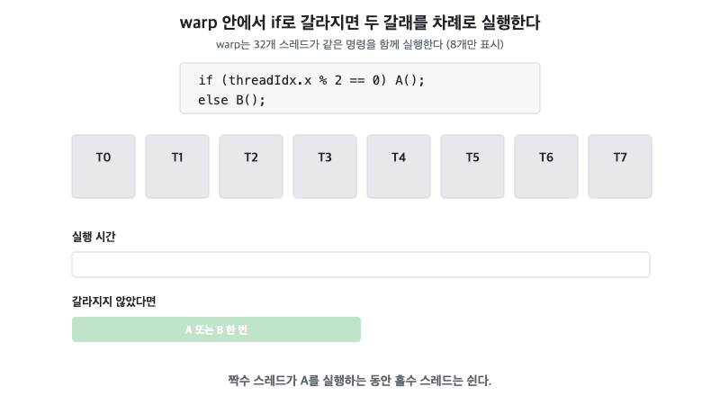
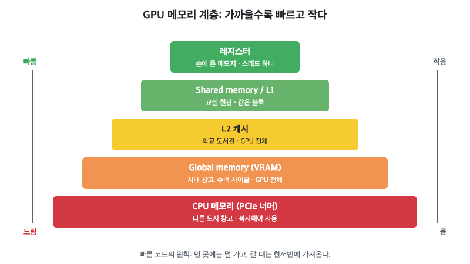
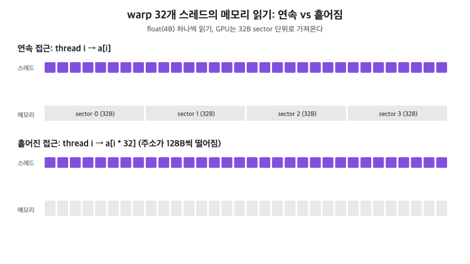

AI 이야기를 하다 보면 CUDA라는 단어가 빠지지 않는다. "PyTorch는 CUDA 위에서 돈다", "CUDA 버전이 안 맞아서 학습이 안 된다", "NVIDIA가 강한 이유는 CUDA 생태계다". 그런데 정작 CUDA가 무엇이고 GPU가 왜 빠른지 물으면 대답이 막히는 경우가 많다.

이 글은 CUDA를 처음 듣는 사람을 기준으로 쓴다. GPU가 CPU와 무엇이 다른지에서 시작해서, CUDA 프로그램이 어떤 순서로 돌아가는지, 스레드 수백만 개를 어떻게 조직하는지, 그리고 GPU 코드를 빠르게 만드는 원리 몇 가지를 그림으로 따라간다.

---

## 한눈에 보기

- CUDA는 NVIDIA GPU에게 그래픽이 아닌 일반 계산을 시키기 위한 플랫폼이다.
- CPU는 똑똑한 코어 몇 개, GPU는 단순한 코어 수천 개다. GPU는 같은 계산을 많은 데이터에 동시에 할 때 빠르다.
- CUDA 프로그램은 "GPU 메모리 확보 → 데이터 복사 → 계산 → 결과 복사 → 해제" 순서로 돈다.
- 커널은 수많은 스레드가 동시에 실행하는 함수다. 스레드는 자기 번호로 자기 몫을 고른다.
- 스레드는 Grid, Block, Thread로 조직되고, 하드웨어에서는 32개씩 warp로 묶여 실행된다.
- 성능은 대개 메모리가 결정한다. 복사를 줄이고, 가까운 메모리를 쓰고, 연속된 주소를 읽어야 한다.

---

## 1. CUDA는 무엇인가

GPU는 원래 화면의 픽셀 수백만 개를 동시에 칠하려고 만든 칩이다. 픽셀 하나하나에 하는 계산은 단순하지만 개수가 엄청나게 많다. 그런데 이 "같은 계산을 많은 데이터에 동시에"라는 성질이 행렬 계산, 과학 시뮬레이션, 신경망 학습에도 그대로 들어맞았다.

CUDA(Compute Unified Device Architecture)는 이 능력을 그래픽 바깥에서 쓸 수 있게 NVIDIA가 열어준 통로다[1]. 구체적으로는 아래 것들이 한 묶음이다.

- C/C++를 조금 확장한 문법 (GPU에서 돌 함수를 표시하고 실행하는 문법)
- 컴파일러 `nvcc`
- 런타임과 드라이버
- 행렬, 신경망, 통신용 라이브러리 (cuBLAS, cuDNN, NCCL 등)

---

## 2. CPU와 GPU는 무엇이 다른가

비유하면 CPU는 박사 몇 명, GPU는 계산원 수천 명이다.



그림에서 GPU 코어 하나는 CPU 코어보다 세 배 느리게 설정했다. 그래도 64개를 한꺼번에 처리하니 전체 작업은 훨씬 먼저 끝난다.

| | CPU | GPU |
|---|---|---|
| 코어 | 수 개~수십 개, 각각 매우 똑똑함 | 수천 개, 각각은 단순함 |
| 잘하는 일 | 복잡한 분기, 순서가 중요한 일, 빠른 응답 | 같은 계산을 대량의 데이터에 동시에 적용 |
| 설계 목표 | 한 작업을 최대한 빨리 끝냄 (latency) | 전체 작업량을 최대한 많이 처리 (throughput) |
| 예시 | OS, 웹 서버, DB 질의 처리 | 행렬곱, 이미지 처리, 신경망 학습 |

시험지 1만 장을 채점한다면 박사 4명보다 계산원 1,000명이 훨씬 빨리 끝낸다. 반대로 어려운 논문 한 편을 쓰는 일은 계산원이 1,000명 있어도 도움이 안 된다. GPU가 모든 일에서 빠르지 않은 이유가 이것이다.

---

## 3. CUDA 프로그램의 기본 흐름

CUDA 프로그램에는 두 주인공이 있다.

- Host: CPU와 일반 메모리(RAM). 프로그램 전체를 지휘한다.
- Device: GPU와 GPU 전용 메모리(VRAM). 무거운 계산을 맡는다.

둘의 메모리는 따로 있다. 그래서 GPU가 계산하려면 데이터를 먼저 GPU로 옮겨야 한다.



```
1. GPU 메모리 확보            cudaMalloc
2. 데이터를 CPU → GPU로 복사   cudaMemcpy(..., cudaMemcpyHostToDevice)
3. GPU에서 계산 실행          kernel<<<...>>>(...)
4. 결과를 GPU → CPU로 복사    cudaMemcpy(..., cudaMemcpyDeviceToHost)
5. GPU 메모리 해제            cudaFree
```

복사는 PCIe라는 통로를 거친다. GPU 내부 메모리보다 훨씬 느린 길이다. 그래서 "계산은 1초면 되는데 복사에 3초"인 상황이 실제로 생긴다. 데이터를 한 번 GPU로 옮겼으면 최대한 GPU 안에서 여러 번 쓰고 나오는 게 좋다.

---

## 4. 커널: 반복문 대신 스레드

커널(kernel)은 GPU에서 실행되는 함수다. 일반 함수와 다른 점은 한 번 호출하면 같은 코드가 수천~수백만 개의 스레드에서 동시에 실행된다는 것이다.

두 배열을 더하는 예로 비교해 보자.



CPU 방식은 한 명이 처음부터 끝까지 차례로 더한다.

```c
for (int i = 0; i < N; i++)
    c[i] = a[i] + b[i];
```

CUDA 방식은 스레드 N개가 각자 한 칸씩 동시에 더한다.

```c
__global__ void add(const float *a, const float *b, float *c, int N) {
    int i = blockIdx.x * blockDim.x + threadIdx.x;  // 나는 몇 번째 스레드인가?
    if (i < N)                                       // 배열 밖은 건너뛴다
        c[i] = a[i] + b[i];                          // 내 칸만 계산
}

// 호출: 스레드 256개짜리 묶음을 필요한 만큼 실행
add<<<(N + 255) / 256, 256>>>(a, b, c, N);
```

- `__global__`은 "이 함수는 GPU에서 돈다"는 표시다.
- 반복문이 사라졌다. 스레드마다 자기 번호 `i`를 계산해서 자기 몫만 처리한다.
- `<<<블록 수, 블록당 스레드 수>>>`는 스레드를 몇 개 띄울지 정하는 CUDA 전용 문법이다.
- `if (i < N)`이 필요한 이유는 스레드를 256개 단위로 띄우기 때문이다. N이 256의 배수가 아니면 남는 스레드가 생긴다.

---

## 5. 스레드 조직: Grid, Block, Thread

스레드 수백만 개를 그냥 풀어놓으면 관리가 안 된다. 그래서 CUDA는 학교처럼 계층을 둔다[1].



| 단위 | 비유 | 특징 |
|---|---|---|
| Thread | 학생 | 가장 작은 실행 단위. 자기 번호로 할 일을 정함 |
| Block | 반 | 같은 반끼리는 공유 메모리로 협력하고 서로 기다려 줄 수 있음 |
| Grid | 학교 | 커널 한 번 호출로 만들어지는 블록 전체 |

스레드의 전체 번호는 "몇 번째 반인가 × 반 인원 + 반 안에서 몇 번째인가"로 계산한다. 그림에서 Block 1의 T3은 `1 × 8 + 3 = 11`이니 `c[11]`을 맡는다.

반끼리는 서로 기다려 주지 않는다. 블록이 어떤 순서로 실행될지 보장되지 않기 때문이다. 이게 제약처럼 보이지만 사실 장점이다. 작은 GPU는 블록을 몇 개씩 차례로 처리하고 큰 GPU는 한꺼번에 많이 처리하니, 같은 코드가 GPU 크기와 상관없이 돌아간다.

---

## 6. 하드웨어에서 실제로 일어나는 일: SM과 warp

GPU 안에는 SM(Streaming Multiprocessor)이라는 작업장이 수십~백여 개 있다. 블록 하나는 SM 하나에 배정된다. 그리고 SM은 스레드를 32개씩 묶어서 실행하는데, 이 묶음을 warp라고 한다[1]. warp 안의 32개 스레드는 같은 명령을 함께 실행한다. 구령에 맞춰 같은 동작을 하는 조와 비슷하다.

여기서 GPU 성능을 좌우하는 원리 두 가지가 나온다.

### 기다리는 시간은 다른 warp로 메운다

GPU 메모리에서 데이터를 가져오는 데는 수백 사이클이 걸린다. 그동안 SM이 놀면 아깝다. 그래서 SM은 준비된 다른 warp로 바로 갈아탄다.



warp가 하나뿐이면 SM은 대부분의 시간을 기다리며 보낸다. warp가 넷이면 한 warp가 메모리를 기다리는 동안 다른 warp가 계산해서, SM이 거의 쉬지 않는다. GPU에 스레드를 넉넉히 띄워야 하는 이유가 이것이다. 일감이 적으면 이 기다림을 메울 수 없다.

### warp 안에서 갈라지면 두 번 걸린다

warp 안의 스레드는 같은 명령을 함께 실행한다. 그런데 `if`로 길이 갈리면 어떻게 될까?



GPU는 두 갈래를 차례로 실행한다. 짝수 스레드가 A를 하는 동안 홀수 스레드는 쉬고, 그다음 홀수가 B를 하는 동안 짝수가 쉰다. 이를 warp divergence라고 한다. 분기가 많고 불규칙한 코드가 GPU에서 느린 이유다.

---

## 7. 메모리 계층: 성능은 대개 메모리가 결정한다

GPU 코드가 느린 이유는 계산보다 메모리 쪽인 경우가 훨씬 많다.



| 메모리 | 비유 | 공유 범위 |
|---|---|---|
| 레지스터 | 손에 든 메모지 | 스레드 하나 |
| Shared memory / L1 | 교실 칠판 | 같은 블록 |
| L2 캐시 | 학교 도서관 | GPU 전체 |
| Global memory (VRAM) | 시내 창고 | GPU 전체 |
| CPU 메모리 (PCIe 너머) | 다른 도시 창고 | 복사해야 사용 |

빠른 코드의 원칙은 두 문장이다.

- 먼 곳에는 덜 간다. 창고에서 한 번 가져온 데이터는 칠판(Shared memory)에 두고 여러 번 쓴다.
- 갈 때는 한꺼번에 가져온다.

두 번째 원칙이 coalescing이다. GPU는 메모리를 32바이트 sector 단위로 가져온다[2]. warp의 32개 스레드가 연속된 주소를 읽으면 요청이 몇 건으로 합쳐진다. 주소가 흩어져 있으면 요청이 스레드 수만큼 쪼개진다.



- 연속 접근 `a[i]`: float(4B) 32개 = 128B. sector 4개로 끝나고, 가져온 데이터를 전부 쓴다.
- 흩어진 접근 `a[i * 32]`: 스레드마다 다른 sector를 건드린다. 32B짜리 sector 32개, 총 1,024B를 가져와서 128B만 쓴다. 대역폭의 87.5%를 버리는 셈이다.

배열 구조를 바꾸는 것만으로 속도가 몇 배 달라지는 이유가 여기 있다. 구조체 배열(AoS)을 필드별 배열(SoA)로 바꾸는 게 대표적인 방법이다.

---

## 8. GPU가 빠른 일과 느린 일

지금까지 본 원리로 GPU에 맞는 일과 안 맞는 일을 가를 수 있다.

GPU에 잘 맞는 일:
- 같은 연산을 대량의 독립된 데이터에 적용하는 일 (행렬곱, 이미지 필터, 신경망 학습과 추론)
- 데이터가 크고, 한 번 GPU로 옮기면 여러 번 계산하는 일

GPU에 잘 안 맞는 일:
- 데이터가 작은 일: 복사와 실행 준비 비용이 계산보다 크다.
- 순서 의존이 강한 일: 앞 결과가 있어야 다음 계산을 할 수 있으면 나눠 맡길 수 없다.
- 분기가 많고 불규칙한 일: warp divergence가 생기고 메모리 접근이 흩어진다.

---

## 9. 직접 짜지 않아도 쓰고 있는 CUDA

대부분은 커널을 직접 쓰지 않는다. CUDA 위에 쌓인 라이브러리를 쓴다.

```
PyTorch / TensorFlow / JAX       ← 보통 여기서 작업
   ↓
cuBLAS (행렬), cuDNN (신경망), NCCL (GPU 간 통신)
   ↓
CUDA Runtime / Driver
   ↓
GPU
```

PyTorch로 보면 이렇게 연결된다.

```python
import torch

a = torch.randn(4096, 4096)
b = torch.randn(4096, 4096)

a = a.to("cuda")   # 3장의 CPU → GPU 복사
b = b.to("cuda")
c = a @ b          # 4~7장의 커널 실행 (cuBLAS 행렬곱)
c = c.cpu()        # 3장의 GPU → CPU 복사
```

`.to("cuda")` 한 줄 아래에서 `cudaMalloc`과 `cudaMemcpy`가 일어나고, `a @ b` 한 줄 아래에서 수백만 개의 스레드가 Grid, Block, warp로 나뉘어 돈다. 그래서 학습 코드에서 매 스텝 `.cpu()`나 `.item()`으로 값을 꺼내면 느려진다. 그때마다 GPU를 기다렸다가 PCIe로 복사하기 때문이다.

---

## 마무리

CUDA를 한 줄로 줄이면 "같은 일을 수천 명에게 동시에 나눠 시키는 방법"이다. 나눠 시키려면 각자 자기 몫을 알아야 하고(스레드 번호), 반 단위로 묶어 관리해야 하고(Block, Grid), 재료를 멀리서 가져오는 시간을 아껴야 한다(메모리 계층, coalescing). GPU 코드가 빠르거나 느린 이유는 대부분 이 세 가지 중 하나에서 나온다.

## 참고

1. [NVIDIA CUDA C++ Programming Guide](https://docs.nvidia.com/cuda/cuda-c-programming-guide/index.html)
2. [NVIDIA CUDA C++ Best Practices Guide](https://docs.nvidia.com/cuda/cuda-c-best-practices-guide/index.html)
3. [An Even Easier Introduction to CUDA (NVIDIA 기술 블로그)](https://developer.nvidia.com/blog/even-easier-introduction-cuda/)
4. [How to Access Global Memory Efficiently in CUDA C/C++ Kernels (NVIDIA 기술 블로그)](https://developer.nvidia.com/blog/how-access-global-memory-efficiently-cuda-c-kernels/)
