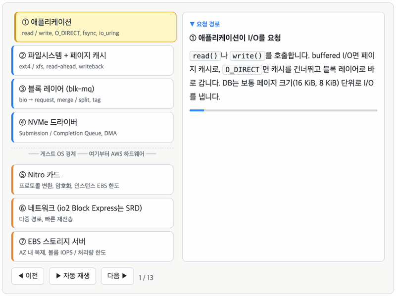
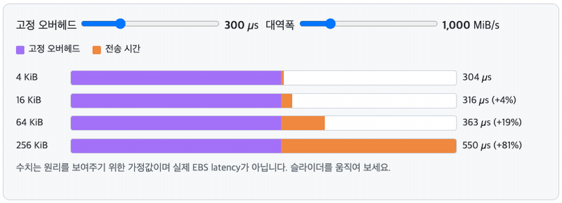
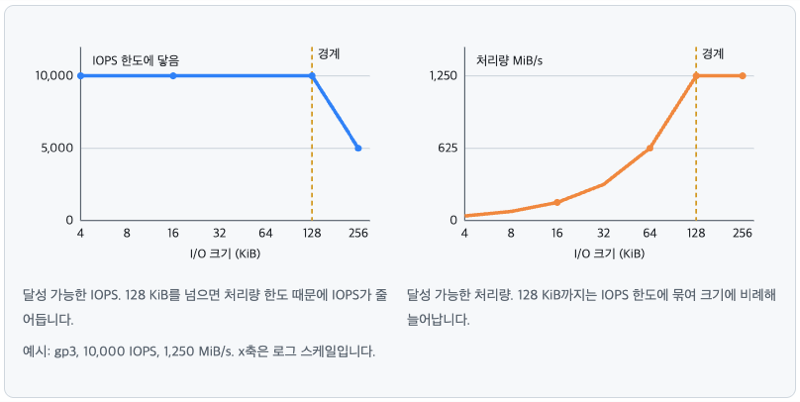
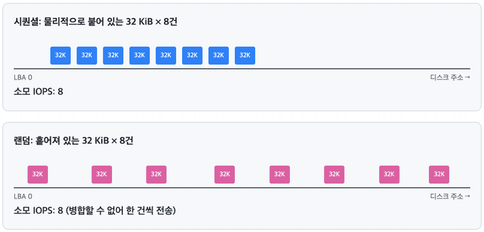
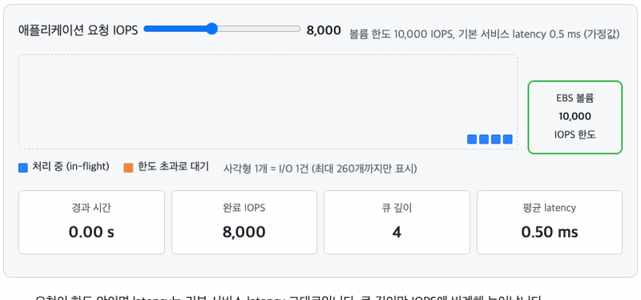
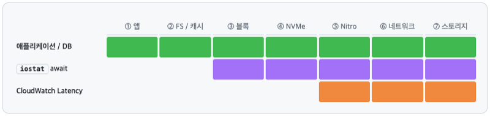

EBS 볼륨 타입을 고르다 보면 문서에서 이런 문장을 자주 만난다. "io2 Block Express는 16 KiB I/O 기준 평균 500 µs 미만의 latency를 내도록 설계되었다." 그런데 실제로 CloudWatch를 열어보면 숫자가 그보다 크게 나오는 경우가 많다. 그러면 질문이 이어진다. I/O 크기가 커지면 latency는 얼마나 늘어날까? 시퀀셜과 랜덤은 SSD에서도 차이가 날까? gp3로 바꾸면 얼마나 느려질까?

이 질문들에 답하려면 I/O 한 건이 애플리케이션에서 EBS 스토리지 서버까지 어떤 경로를 지나는지부터 알아야 한다. 이 글은 그 경로를 그림으로 따라가고, 거기서 I/O 크기, 시퀀셜과 랜덤, 큐 깊이가 각각 어떻게 latency를 바꾸는지 정리한다.

---

## 한눈에 보기

- EBS는 네트워크 너머의 디스크다. 그래서 I/O 한 건에는 크기와 무관한 왕복 비용이 붙는다.
- latency는 "고정 오버헤드 + 전송 시간"이다. 작은 I/O에서는 크기를 바꿔도 거의 같고, 클수록 선형에 가깝게 늘어난다.
- 볼륨에는 IOPS 한도와 처리량 한도가 함께 있다. `처리량 한도 ÷ IOPS 한도`보다 큰 I/O는 처리량 한도에 먼저 걸린다.
- SSD 기반 EBS에서 시퀀셜의 이점은 seek이 아니라 merge와 read-ahead에서 나온다.
- 한도를 넘는 요청은 큐에 쌓이고, 그때부터 latency는 큐 깊이에 비례해 늘어난다.
- latency 값을 비교할 때는 어디서 쟀는지부터 맞춰야 한다.

---

## 1. I/O 한 건이 지나가는 경로

EC2 인스턴스 안에서 EBS 볼륨은 `/dev/nvme1n1` 같은 NVMe 디스크로 보인다. 하지만 실제 데이터는 같은 가용 영역의 EBS 스토리지 서버에 있다. 아래 그림은 read 한 건이 내려갔다가 돌아오는 13단계를 따라간다.



단계별로 핵심만 정리하면 다음과 같다.

| 단계 | 하는 일 | 성능에 주는 영향 |
|---|---|---|
| ① 애플리케이션 | 시스템 콜로 I/O 요청 | DB 페이지 크기가 곧 I/O 크기 (InnoDB 16 KiB, PostgreSQL 8 KiB) |
| ② 파일시스템 + 페이지 캐시 | 캐시 히트면 디스크에 가지 않음 | buffered write는 메모리 복사 후 즉시 반환, `fsync`는 저널 기록까지 대기 |
| ③ 블록 레이어 (blk-mq) | 인접 I/O 병합, 큰 I/O 분할 | 시퀀셜 I/O가 적은 수의 큰 I/O로 바뀜 |
| ④ NVMe 드라이버 | 명령을 Submission Queue에 넣고 doorbell로 알림 | 데이터는 DMA로 이동, CPU 복사 없음 |
| ⑤ Nitro 카드 | NVMe 명령을 EBS 프로토콜로 변환, 암호화 | 인스턴스 타입별 EBS 대역폭과 IOPS 한도 적용 |
| ⑥ 네트워크 | 스토리지 서버와 통신 | io2 Block Express는 SRD로 지터와 꼬리 지연을 줄임 |
| ⑦ EBS 스토리지 서버 | 복제 후 응답 | write는 복제 완료까지 기다림, 볼륨 한도 적용 |

### 애플리케이션: 어떤 방식으로 I/O를 보내는가

| 방식 | 동작 | 사용 예 |
|---|---|---|
| `read()` / `write()` (buffered) | 페이지 캐시를 거친다. write는 메모리에 복사만 하고 반환 | 일반 애플리케이션 |
| `O_DIRECT` | 페이지 캐시를 건너뛰고 블록 레이어로 직행. 버퍼와 오프셋을 블록 크기에 맞춰야 함 | MySQL `innodb_flush_method=O_DIRECT`, Oracle |
| `fsync()` / `O_DSYNC` | 디스크에 기록될 때까지 대기 | DB 커밋, redo/WAL |
| `libaio` / `io_uring` | 여러 I/O를 비동기로 한꺼번에 보냄 | DB, fio |

io2 Block Express 문서가 16 KiB를 기준으로 삼은 것도 이런 OLTP DB의 페이지 크기를 염두에 둔 것으로 보인다.

### 페이지 캐시: 디스크에 가지 않는 I/O

read는 캐시에 있으면 EBS I/O가 0건이다. 없으면 파일시스템(ext4, xfs)이 파일 오프셋을 디스크 블록 주소(LBA)로 바꿔 bio를 만든다. 순차 접근이라고 판단되면 read-ahead가 다음 데이터를 미리 요청한다(`/sys/block/<dev>/queue/read_ahead_kb`).

write는 페이지 캐시에 쓰고 바로 반환한다. 실제 디스크 기록은 나중에 flusher 스레드가 모아서 한다(writeback). 그런데 `fsync()`를 부르면 데이터뿐 아니라 저널(ext4 jbd2, xfs log) 기록과 flush가 함께 일어난다. 애플리케이션은 한 번 썼는데 디스크에는 두세 건이 나가는 이유가 이것이다.

### 블록 레이어: 합치고, 나누고, 줄 세운다

```
bio (시작 섹터 + 길이 + 메모리 세그먼트)
  → plug: 같은 태스크가 연속으로 낸 bio를 잠깐 모음
  → merge: 앞뒤로 붙은 섹터면 하나의 request로 합침
  → split: max_sectors_kb / max_segments를 넘으면 쪼갬
  → 스케줄러: NVMe는 보통 none
  → tag 할당: 하드웨어 큐마다 동시 처리 개수 제한
  → 하드웨어 큐로 dispatch
```

blk-mq는 CPU별 소프트웨어 큐를 NVMe 하드웨어 큐에 연결한다. 여러 코어가 lock 경합 없이 동시에 I/O를 보낼 수 있다. tag가 모자라면 request가 여기서 기다리는데, 이 대기는 뒤에서 볼 CloudWatch latency에는 잡히지 않는다.

### NVMe 드라이버, Nitro 카드, 그리고 네트워크

드라이버는 request를 64바이트 NVMe 명령으로 바꿔 Submission Queue에 넣고, doorbell 레지스터를 써서 디바이스에 알린다. 데이터는 DMA로 직접 옮겨진다.

게스트가 보는 "NVMe 디스크"의 실체는 Nitro 카드다. Nitro 카드가 명령을 EBS 프로토콜로 바꾸고, 암호화 볼륨이면 하드웨어로 암호화한다. 인스턴스 타입별 EBS 한도도 여기서 적용된다.

io2 Block Express는 SRD(Scalable Reliable Datagram) 프로토콜로 스토리지 서버와 통신한다. 패킷을 여러 경로로 나눠 보내고 유실되면 빠르게 다시 보내서, 네트워크 지터와 꼬리 지연을 줄인다[1].

### 스토리지 서버와 완료 경로

EBS 데이터는 같은 가용 영역 안에서 복제된다. write는 복제가 끝나야 응답하므로 일반적으로 read보다 latency가 높다. 응답이 돌아오면 Nitro 카드가 데이터를 DMA로 게스트 메모리에 쓰고, Completion Queue에 완료 항목을 남긴 뒤 인터럽트를 올린다. 드라이버가 이를 처리하고, bio 완료 콜백을 거쳐 시스템 콜이 반환된다.

---

## 2. latency = 고정 오버헤드 + 전송 시간

I/O 한 건의 latency는 이렇게 나눠 생각하면 이해하기 쉽다.

```
latency ≈ 고정 오버헤드 (왕복, 처리, 복제) + (I/O 크기 ÷ 대역폭)
```

고정 오버헤드를 300 µs, 대역폭을 1,000 MiB/s로 가정하고 계산해 보자.



| I/O 크기 | 전송 시간 | 합계 | 4 KiB 대비 |
|---|---|---|---|
| 4 KiB | 약 4 µs | 약 304 µs | 기준 |
| 16 KiB | 약 16 µs | 약 316 µs | +4% |
| 64 KiB | 약 63 µs | 약 363 µs | +19% |
| 256 KiB | 약 250 µs | 약 550 µs | +81% |

> 이 수치는 원리를 보여주기 위한 가정값이다. 실제 EBS latency가 아니다.
{: .prompt-warning }

그림에서 보이듯 latency는 I/O 크기에 단순 비례하지 않는다. 작은 I/O에서는 고정 오버헤드가 대부분이라 4 KiB와 16 KiB가 거의 같다. 크기가 커질수록 전송 시간의 비중이 늘어나서 증가 폭이 선형에 가까워진다. 고정 오버헤드는 인스턴스, 볼륨 타입, read/write 비율에 따라 달라서 "I/O 크기가 두 배면 latency가 몇 배"라는 공식 비율은 없다. 그래서 공식 문서도 latency를 특정 I/O 크기 기준으로만 적는다.

---

## 3. IOPS 한도와 처리량 한도의 경계

볼륨에는 IOPS 한도와 처리량 한도가 함께 있다. 둘은 `처리량 = IOPS × I/O 크기`로 묶여 있으니, I/O 크기에 따라 어느 한도에 먼저 닿는지가 달라진다.

```
경계 I/O 크기 = 처리량 한도 ÷ IOPS 한도
예) gp3 10,000 IOPS / 1,250 MiB/s → 1,250 MiB ÷ 10,000 = 128 KiB
```



128 KiB보다 작은 I/O는 IOPS 한도에 먼저 닿고, 처리량은 크기에 비례해 늘어난다. 128 KiB보다 큰 I/O는 처리량 한도에 먼저 닿아서, 실제 IOPS가 프로비저닝한 10,000보다 낮게 나온다. 256 KiB면 5,000 IOPS가 상한이다.

> EBS SSD 볼륨은 I/O 한 건을 최대 256 KiB 단위로 센다. 1,024 KiB I/O 한 건은 256 KiB 네 건(4 IOPS)으로 나뉘고, 4 KiB I/O도 1 IOPS로 센다[2].
{: .prompt-info }

---

## 4. 시퀀셜과 랜덤: merge의 힘

HDD에서 랜덤 I/O가 느린 이유는 명확하다. 헤드가 움직이는 seek과 원판이 돌아오기를 기다리는 회전 대기가 매번 생긴다. 그런데 EBS 문서는 SSD 기반 볼륨(gp2, gp3, io1, io2)이 랜덤이든 시퀀셜이든 일관된 성능을 낸다고 말한다[2]. 그렇다면 SSD에서 시퀀셜의 이점은 어디서 올까? 답은 merge다.



- 물리적으로 붙어 있는 32 KiB I/O 8건은 OS나 EBS가 256 KiB 한 건으로 합친다. 1 IOPS만 쓴다.
- 흩어진 32 KiB I/O 8건은 합칠 수 없으니 8 IOPS를 쓴다.
- I/O 한 건의 latency 자체는 거의 같다. 차이는 같은 IOPS 한도 안에서 옮길 수 있는 데이터 양이다.
- 시퀀셜 read는 read-ahead가 다음 데이터를 미리 가져오므로 애플리케이션이 느끼는 지연이 더 줄어든다.

---

## 5. 큐 깊이와 Little's Law

큐 깊이(queue depth, QD)는 보냈지만 아직 완료되지 않은 I/O의 개수다. 세 값은 Little's Law로 묶인다.

```
QD = IOPS × 평균 latency(초)
예) 10,000 IOPS × 0.001초(1 ms) = QD 10
```

EBS 문서는 일관된 성능을 위해 프로비저닝 IOPS 1,000당 평균 큐 깊이 1을 유지하라고 권장한다[2]. latency가 1 ms일 때 딱 한도만큼 쓰는 큐 깊이다.

요청이 한도를 넘으면 어떻게 될까? 볼륨 한도 10,000 IOPS, 기본 서비스 latency 0.5 ms를 가정하고 시뮬레이션해 봤다. 앞부분은 8,000 IOPS, 뒷부분은 13,000 IOPS로 요청한다.



- 8,000 IOPS: 한도 안이다. latency는 기본값 0.5 ms 그대로이고, 큐 깊이는 8,000 × 0.0005 = 4다.
- 13,000 IOPS: 초당 3,000건씩 처리하지 못한 I/O가 쌓인다. 완료 IOPS는 10,000에 묶이고, latency는 `큐 깊이 ÷ 10,000`으로 계속 늘어난다.

latency를 두 종류로 나눠 보면 정리가 된다.

- 서비스 지연: EBS가 I/O 한 건을 처리하는 시간. I/O 크기와 볼륨 타입에 따라 달라진다.
- 대기 지연: 한도에 걸려 큐에서 기다리는 시간. 한도를 넘는 순간부터 지배적이 된다.

실제 DB처럼 동시 요청 수가 고정된 워크로드는 큐가 끝없이 쌓이지 않는다. 대신 latency가 늘어난 만큼 처리량(TPS)이 줄어든다. 그리고 CloudWatch 지표는 1분 평균이라 초 단위 버스트가 희석된다. 한도 초과 여부는 `VolumeIOPSExceededCheck`, `VolumeThroughputExceededCheck`로 따로 봐야 한다[3].

---

## 6. 어디서 재느냐에 따라 latency가 다르다

같은 I/O라도 측정 지점에 따라 포함되는 구간이 다르다.



| 측정값 | 특징 |
|---|---|
| CloudWatch `VolumeAvgReadLatency` / `VolumeAvgWriteLatency` | 스토리지 쪽 latency. 게스트 OS 안의 대기는 빠짐. 1분 동안 완료된 I/O의 평균 |
| `iostat` `r_await` / `w_await` | 블록 레이어 대기가 들어가서 CloudWatch보다 클 수 있음 |
| 애플리케이션 / DB 측정값 | 캐시 히트면 훨씬 작고, fsync와 저널 기록이 붙으면 훨씬 큼 |

문서의 "500 µs"와 내가 본 숫자를 비교하기 전에, 내 숫자가 어느 지점에서 잰 것인지부터 확인해야 한다. CloudWatch 값이라도 I/O 크기가 16 KiB보다 크거나, write 비중이 높거나, 트래픽이 적어 1분 평균이 소수의 outlier에 끌려간 구간이라면 같은 조건의 비교가 아니다.

---

## 7. 직접 확인해 보기

### OS에서 실시간으로 보기

```bash
$ iostat -x 1 nvme1n1
```

| 컬럼 | 의미 |
|---|---|
| `r/s`, `w/s` | 초당 IOPS (merge 후) |
| `rrqm/s`, `wrqm/s` | 병합된 요청 수. 높으면 시퀀셜 성향 |
| `rareq-sz`, `wareq-sz` | 평균 I/O 크기 (KiB) |
| `r_await`, `w_await` | 평균 latency (ms). 게스트 대기 포함 |
| `aqu-sz` | 평균 큐 깊이 |

### 블록 레이어 설정 확인

```bash
$ cat /sys/block/nvme1n1/queue/{scheduler,nr_requests,max_sectors_kb,read_ahead_kb}
```

### CloudWatch로 계산하기

```
평균 read I/O 크기 (KiB) = Sum(VolumeReadBytes) / Sum(VolumeReadOps) / 1024
평균 read IOPS           = Sum(VolumeReadOps) / 기간(초)
평균 read latency (ms)   = VolumeAvgReadLatency
```

Nitro 인스턴스에서는 latency 분포를 히스토그램으로 주는 EBS 상세 성능 통계도 쓸 수 있다[4].

### fio로 I/O 크기별 latency 재기

> 아래 명령은 원시 디바이스에 직접 read한다. 반드시 테스트용 볼륨에서 실행하자. write 테스트(`--rw=randwrite`)는 데이터를 덮어쓰므로 운영 볼륨에서는 절대 돌리면 안 된다.
{: .prompt-danger }

```bash
$ for bs in 4k 16k 64k 256k; do
    sudo fio --name=lat-$bs --filename=/dev/nvme1n1 --direct=1 \
      --rw=randread --bs=$bs --iodepth=1 --numjobs=1 \
      --ioengine=libaio --runtime=60 --time_based --group_reporting \
      | grep -E "clat \(|iops"
  done
```

`--iodepth=1`로 큐잉을 없애면 I/O 크기에 따른 순수 서비스 latency가 보인다. 이어서 `--iodepth`를 8, 16, 32로 올려 보면 5장의 Little's Law가 실제로 맞아떨어지는지 확인할 수 있다. 볼륨 타입을 비교하고 싶다면 스냅샷으로 같은 데이터를 가진 gp3, io2 볼륨을 만들어 같은 명령을 돌리는 게 가장 확실하다.

---

## 마무리

정리하면 EBS의 latency는 세 가지 질문으로 풀린다. I/O가 얼마나 큰가(전송 시간), 한도 안에 있는가(대기 지연), 어디서 쟀는가(측정 구간). 문서의 숫자와 내 숫자가 다를 때 이 세 가지를 차례로 맞춰 보면 대부분 이유가 나온다. 볼륨 타입을 바꾸는 판단도 결국 내 워크로드의 I/O 크기와 peak IOPS를 먼저 재고, 테스트 볼륨에서 fio로 확인하는 순서가 가장 빠르다.

## 참고

1. [Amazon EBS 프로비저닝된 IOPS SSD 볼륨 (io2 Block Express)](https://docs.aws.amazon.com/ko_kr/ebs/latest/userguide/provisioned-iops.html)
2. [Amazon EBS I/O 특성 및 모니터링](https://docs.aws.amazon.com/ko_kr/ebs/latest/userguide/ebs-io-characteristics.html)
3. [Amazon EBS CloudWatch 지표](https://docs.aws.amazon.com/ko_kr/ebs/latest/userguide/using_cloudwatch_ebs.html)
4. [Amazon EBS 상세 성능 통계](https://docs.aws.amazon.com/ko_kr/ebs/latest/userguide/nvme-detailed-performance-stats.html)
5. [Amazon EBS 범용 SSD 볼륨 (gp3)](https://docs.aws.amazon.com/ko_kr/ebs/latest/userguide/general-purpose.html)
6. [Amazon EBS와 NVMe](https://docs.aws.amazon.com/ko_kr/ebs/latest/userguide/nvme-ebs-volumes.html)
